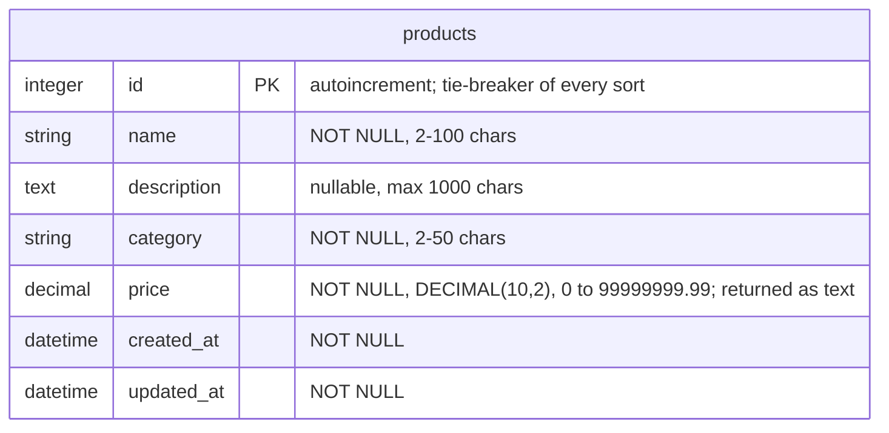
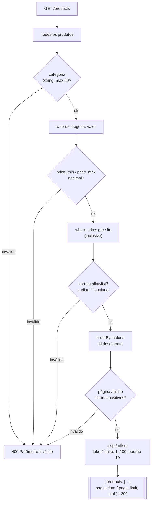

# Product — Queries (normalizado)

Especificação normalizada e centralizada do recurso **Products** (queries),
compartilhado pelos projetos `node-express` e `ruby-sinatra`.

Este documento é a fonte única da verdade (`single source of truth`) para o
comportamento do resource Products. Qualquer alteração no comportamento deve
ser refletida aqui primeiro e, quando aplicável, nos ADRs correspondentes.

## Schema



### price — text on the wire

`price` é **texto na rede**: enviado como string ou número JSON, sempre
retornado como string (`"159.9"`), para que nenhum cliente perca precisão por
causa de ponto flutuante.

## Aceitação de campos

`POST` e `PATCH` aceitam `name, description, category, price`; `POST` exige
`name`, `category` e `price`. Chaves desconhecidas geram `400` (`Unknown fields`)
antes do modelo enxergá-las.

## Pipeline de consulta

`GET /products` executa os estágios abaixo, em ordem. Um parâmetro inválido
interrompe a requisição com `400` nomeando-o.



## Parâmetros

| Parâmetro | Tipo | Padrão | Regras |
|-----------|------|--------|--------|
| `category` | text | — | Correspondência exata; no máximo 50 caracteres |
| `min_price` | decimal | — | Limite inferior inclusivo; número decimal (`10`, `10.5`, `.5`, `-3`) |
| `max_price` | decimal | — | Limite superior inclusivo; mesmo formato |
| `sort` | string | `id` | Um de `id`, `name`, `price`, `category`, `created_at`; `-` prefixo = desc (`-price`) |
| `page` | integer | `1` | Inteiro positivo, baseado em 1 |
| `limit` | integer | `10` | Inteiro positivo, no máximo `100` (`MAX_LIMIT`) |

- A ordenação sempre adiciona `id`, portanto as páginas são **estáveis** —
  percorrê-las nunca pula nem repete um registro.
- `pagination.total` é a contagem **após** os filtros e **antes** do
  skip/take (ou offset/limit).

## Rotas

| Método | Caminho | Sucesso | Notas |
|--------|---------|---------|-------|
| `GET` | `/products` | `200` | `{ "products": [...], "pagination": { page, limit, total } }` |
| `GET` | `/products/:id` | `200` | `{ "product": {...} }` |
| `POST` | `/products` | `201` | `Location: /products/:id` |
| `PATCH` | `/products/:id` | `200` | Apenas os campos enviados são alterados |

Código específico de cada entidade além dos compartilhados (definidos em
[errors.md](../../shared-configs/docs/errors.md)): nenhum — toda resposta aqui
é compartilhada.

## Exemplos

### Listar com filtro, ordenação e paginação

```http
GET /products?category=peripherals&min_price=10&sort=-price&page=2&limit=5
```

```http
HTTP/1.1 200 OK
Content-Type: application/json

{
  "products": [
    {
      "id": 8,
      "name": "Keyboard",
      "description": "nice",
      "category": "peripherals",
      "price": "159.9",
      "created_at": "2026-10-03T21:22:40.938Z",
      "updated_at": "2026-10-03T21:22:40.938Z"
    }
  ],
  "pagination": { "page": 2, "limit": 5, "total": 42 }
}
```

### Criar

```http
POST /products
Content-Type: application/json

{ "name": "Keyboard", "category": "peripherals", "price": "159.9" }
```

```http
HTTP/1.1 201 Created
Location: /products/8
Content-Type: application/json

{ "product": { "id": 8, "name": "Keyboard", "description": null, "category": "peripherals", "price": "159.9", "created_at": "...", "updated_at": "..." } }
```

### Atualização parcial

```http
PATCH /products/8
Content-Type: application/json

{ "price": "149.9" }
```

Apenas `price` é alterado; `updated_at` é atualizado.

### Parâmetro inválido

```http
GET /products?sort=stock
```

```http
HTTP/1.1 400 Bad Request
Content-Type: application/json

{
  "error": "Invalid parameter",
  "messages": ["sort must be one of: id, name, price, category, created_at"]
}
```

## Notas

- Uma coluna `sort` desconhecida resulta em `400`, nunca ignorada silenciosamente
  — a allowlist mantém nomes de coluna fora da consulta sem validação.
- `price > 0` não é exigido: `0` é aceito; preços negativos são rejeitados.